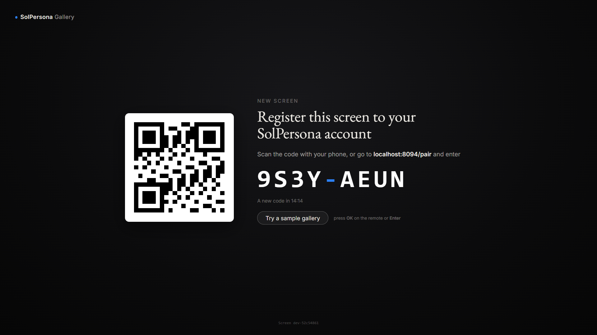
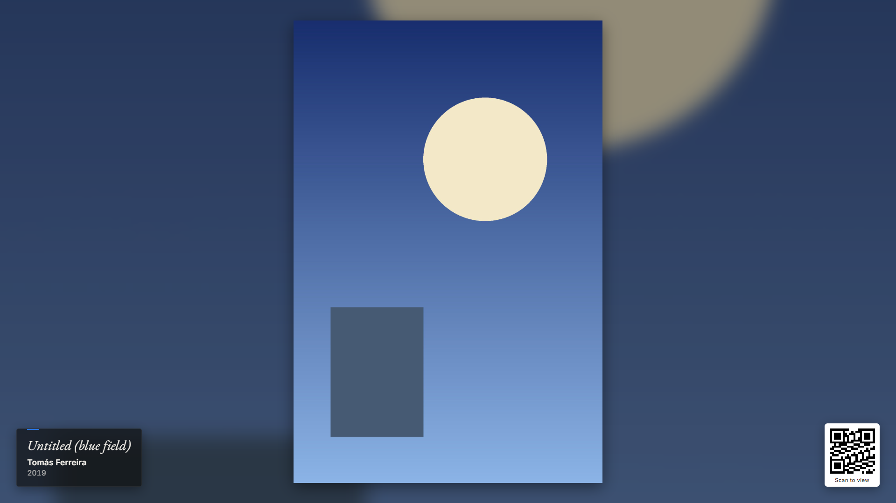
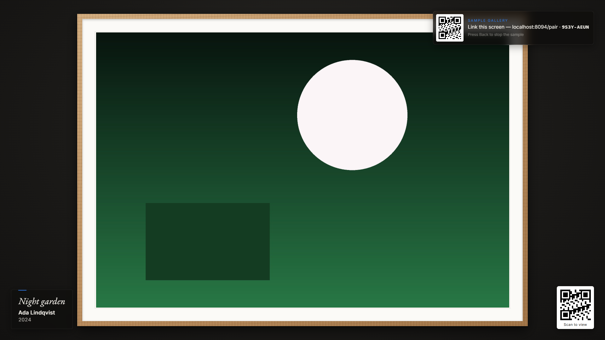
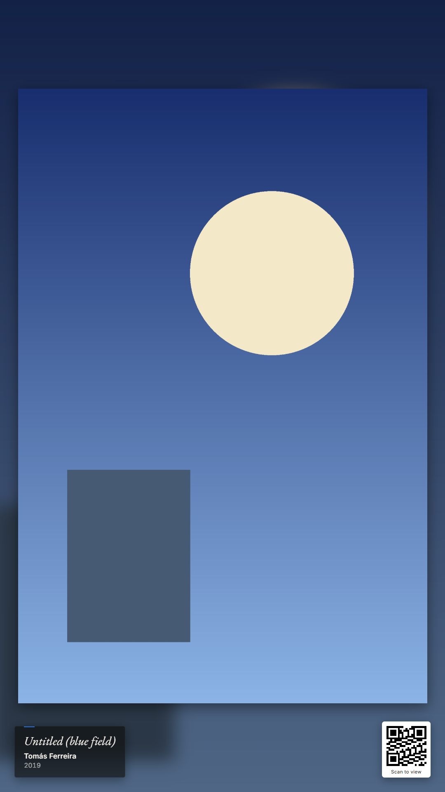

# SolPersona Gallery for Raspberry Pi

A ready-to-flash SD card image that turns a Raspberry Pi behind any HDMI
screen — a monitor, a television, a projector — into a gallery wall for
[SolPersona](https://solpersona.com). Flash the card, plug the Pi into the
screen, scan the code it shows with your phone, and from then on choose what
it shows from SolPersona's dashboard. No desktop, no menus, no keyboard.

It keeps the whole gallery on the card, so it plays on through network drops
and reboots; it plays in step with your other screens; it switches the screen
off outside opening hours; and it is built to survive having its power pulled.



| | |
|---|---|
|  |  |
|  | Screenshots of the player itself, in desktop Chromium, playing synthetic test pieces from the development mock (`dev/`). The QR codes in them are placeholders. |

## What you need

* A **Raspberry Pi 5** (best: 4K at 60 Hz) or **Pi 4** (4K at 30 Hz), with its
  official power supply.
* A **microSD card**, 16 GB or larger (8 GB works for small galleries). An
  "A2"/high-endurance card is worth it for a screen that runs all day.
* A micro-HDMI to HDMI cable, and a screen.
* Wi-Fi, or an Ethernet cable.

## Flash in five steps

1. Download `solpersona-gallery-<version>.img.xz` from this repository's
   **Releases** page.
2. Open [Raspberry Pi Imager](https://www.raspberrypi.com/software/), choose
   your Pi, then **Choose OS → Use custom** and pick the downloaded file.
3. **Choose storage**: your SD card. When Imager offers **OS customisation**,
   choose **Edit settings** and fill in your **Wi-Fi** (name, password,
   country) and your **time zone**. (Skip this if you will use a cable, or if
   you would rather set Wi-Fi up from your phone — see below.)
4. **Write**, then put the card in the Pi, connect the screen, and power it on.
   The first start prepares the card and restarts once or twice — about two
   minutes.
5. The screen shows a code. Scan it with your phone (or go to
   solpersona.com/pair and type it), sign in, name the screen and press
   **Link this screen**. Then choose a gallery in **Dashboard → Gallery
   Exhibition**.

Want to see it working first? Press **OK** on the TV remote (or Enter on a
keyboard) on the pairing screen to **try a sample gallery**; the code stays in
a corner, and linking from your phone switches straight to your own gallery.

## Wi-Fi

* **Raspberry Pi Imager** (step 3 above) is the simplest.
* **A network cable** needs nothing at all.
* **From your phone**: if the screen finds no network about a minute after it
  starts, it opens its own setup Wi-Fi and says so: *"Join Wi-Fi
  SolPersona-Gallery-XXXX on your phone to connect this screen"*, with a QR code
  for it. Join it; a page opens where you choose your Wi-Fi and type its
  password. The screen then joins your network and shows its pairing code. If
  the password was wrong, the setup Wi-Fi comes back with a message.
* Already set up and your router is down for a while? The screen keeps playing
  from its card and reconnects by itself.

## The settings file

The card's boot partition holds `solpersona-gallery.toml`. Any computer can
open it (put the card in; it is the drive called `bootfs`). Every line is
explained in the file; remove the `#` in front of a setting to use it.

| Setting | Default | |
|---|---|---|
| `base_url` | `"https://solpersona.com"` | Which SolPersona the screen belongs to. Changing it unlinks the screen. |
| `screen_name` | — | The name offered when linking (rename it any time in the dashboard). |
| `cache_mb` | `0` | Room for the gallery, in MB. `0`: most of the card's free space. |
| `debug` | `false` | The developer panel at start (`D` toggles it). |
| `rotation` | `0` | `90`, `180` or `270` for a screen hung on its side. |
| `timezone` | — | For opening hours, e.g. `"Europe/London"`, if Imager did not set one. |
| `wifi_country` | — | Two letters, e.g. `"GB"`, if Imager did not set one. |
| `resolution` | `"auto"` | `"4k"`, `"1080p"`, or the panel's own. |
| `screen_off` | `"auto"` | Outside opening hours: HDMI-CEC standby, else HDMI off (`"cec"`, `"hdmi"`, `"black"`). |
| `hotspot_password` | — | A password for the setup Wi-Fi (8–63 characters). |
| `updates` | `true` | Install new versions of the app automatically. |
| `os_updates` | `"weekly"` | Debian security updates, or `"off"`. |
| `optimise_images` | `true` | Store huge originals at the screen's own size. |

## With a remote or a keyboard

Nothing is needed — the wall is controlled from the dashboard — but if a
keyboard is plugged in, or the TV passes its remote through HDMI-CEC:

* **OK / Enter** on the pairing screen: try the sample gallery. **Back / Esc**:
  stop it.
* **OK / Enter** while linked: the screen's name, owner, connection, how much of
  the gallery is stored, the version, and **Forget this account** (press OK
  twice) and **Show debug**. **Back** closes it.

## How it works

Chromium shows the player full screen in the `cage` kiosk compositor; a small
local agent (Python) holds the screen's credential, talks to SolPersona,
keeps the gallery on the card and switches the panel. The root file system is
read-only; everything that must survive a reboot is on a data partition made on
the first start. [`docs/ARCHITECTURE.md`](docs/ARCHITECTURE.md) has the whole
design and the reasons for it; [`docs/solpersona/SPEC.md`](docs/solpersona/SPEC.md)
is the protocol every SolPersona screen follows.

```
player/   the web app on the wall (TypeScript, Vite)
agent/    the local service (Python 3, aiohttp; Debian's packages on the Pi)
image/    the pi-gen stage, systemd units, kiosk, first boot, settings file
dev/      a mock SolPersona and tools to run the whole screen on a laptop
scripts/  packaging and release signing
docs/     architecture, conformance results, open questions; solpersona/ is the shared spec
```

## Development

### Run the screen on your computer

Needs Docker and Node 24 (the current LTS).

```sh
(cd player && npm ci && npm run build)
bash dev/stack.sh up            # a mock SolPersona + the agent, in Debian Bookworm containers
```

Open **http://localhost:8737/** in Chrome — that is the wall — and
**http://localhost:8094/mock** for the mock dashboard: link the screen, play,
pause, next, show a piece now, change settings, send `identify`, fail polls,
remove the screen. `docker pause spg-mock` pulls the network;
`docker restart spg-agent` is a reboot. `bash dev/make-clip.sh` adds a test
film. `bash dev/stack.sh down` stops everything.

To work on the player with live reload, keep the stack up and run
`npm run dev` in `player/`, then open http://localhost:5173/.

### Point at a development SolPersona

A development stack normally runs at `http://localhost:8080`.

* **On a laptop:** `bash dev/stack.sh up --real http://host.docker.internal:8080`
  (the address as the agent's container sees it). If that SolPersona hands out
  media URLs on `localhost`, the agent's container cannot download them; the
  wall then streams them from your browser instead of storing them.
* **On a Pi:** set `base_url = "http://192.168.1.20:8080"` (your machine's LAN
  address) in `solpersona-gallery.toml`. The screen unlinks and shows a new code
  from that SolPersona.

A development run of the agent (`SPG_DEV=1`) never talks to production by
accident: with no address given it uses `http://localhost:8080`.

### Tests

```sh
cd player && npm test                     # test-vectors.json, the tick
docker build -t spg-agent-test -f agent/Dockerfile.test agent
docker run --rm -v "$PWD":/src -w /src/agent spg-agent-test   # vectors, pairing/sync, store, updater
```

The same run in CI on every push, the agent's against Debian Bookworm's own
`python3-aiohttp` and `python3-pil` — exactly what the Pi runs.

### Build the image locally

Needs Docker, ~20 GB of disk, and on an x86 machine `qemu-user-static`
(`sudo apt install qemu-user-static binfmt-support`). 30–60 minutes.

```sh
bash image/build.sh
# → image/deploy/solpersona-gallery-<version>.img.xz and .sha256
```

`RELEASE_REPO=owner/name` makes the image take updates from that repository's
releases; without it, and without `image/release-signing.pub`, updates are off.

## Releases and updates

1. Once: `bash scripts/make-signing-key.sh`; put `release-signing.key` in the
   repository's Actions secret `RELEASE_SIGNING_KEY`, commit
   `image/release-signing.pub`, keep the key safe offline.
2. For each release: set `__version__` in `agent/solpersona_gallery/__init__.py`,
   commit, tag `vX.Y.Z`, push the tag.
3. GitHub Actions runs the tests, builds the image with pi-gen, signs
   `SHA256SUMS` and publishes the image, the app bundle and the signatures.

Screens check once a day. A new version is verified against the signing key
baked into the image, unpacked beside the running one, and switched to at
night (03:00) or outside opening hours; if it does not sync within five minutes
it is rolled back and never tried again. Debian security updates are applied
weekly in the same windows. New system-level changes (services, kiosk) need a
newly flashed image.

## Status

The code is complete and tested in development; **it has not yet been run on a
Raspberry Pi**. [`docs/CONFORMANCE-RESULTS.md`](docs/CONFORMANCE-RESULTS.md)
shows what has been verified and what a hardware run still has to confirm
(first boot and the read-only root, Wi-Fi setup, HDMI-CEC, 4K video, an 8-hour
soak, power cuts). Open questions for SolPersona are in
[`docs/QUESTIONS.md`](docs/QUESTIONS.md).

## Security and licence

See [`SECURITY.md`](SECURITY.md) for how the screen's one credential is kept and
how to report a problem. The code is proprietary — see [`LICENSE`](LICENSE);
released images may be flashed and used as SolPersona screens.
